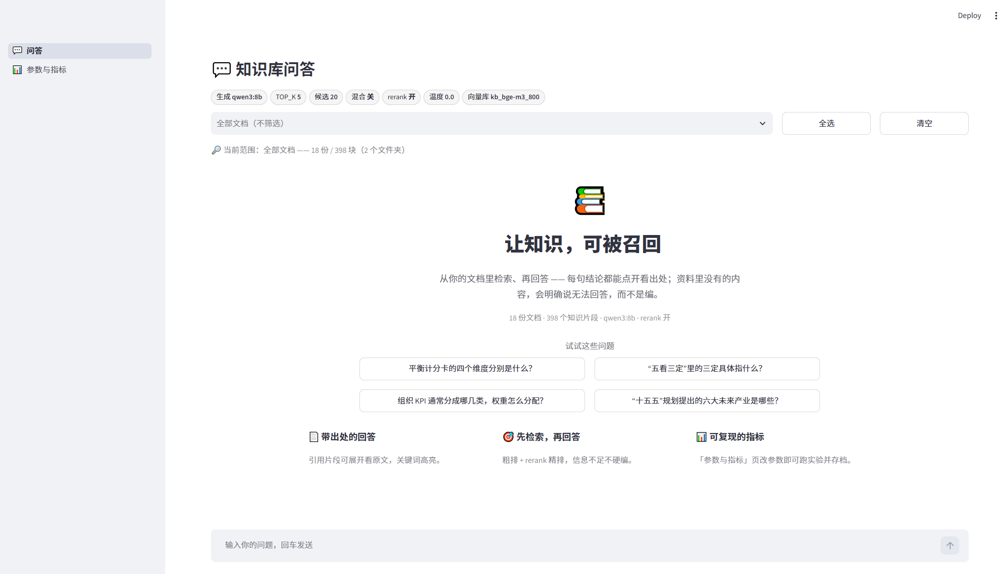

# KnowledgeBase · 本地 RAG 问答与评测


**一套可复现、可解释、可归因的本地 RAG 评测工具链。**
Ollama 跑模型 + 纯 numpy 暴力余弦 + Ragas 四指标，**不依赖 LangChain、不依赖向量数据库**。

它只回答一个问题：**改了一个参数，分数到底变好了没有？**



## ✨ 它解决什么

| 常见困境 | 这套工具怎么做 |
|---|---|
| 界面只给文件名，看不到检索到的原文 | 检索结果就是代码变量，四个指标全能算 |
| 调参靠感觉，改完不知道有没有变好 | 每次实验写一行存档，历史表 / 走势图 / 最近两次差值都能看 |
| 分数掉了，不知道是检索的锅还是生成的锅 | 检索侧与生成侧指标分开；还能只重算检索两项 |
| 调一个参数要等一小时 | 「快速检索实验」**2~10 分钟**出结果（不重新生成回答） |

## 🔢 实测数字（20 题 / 398 块 / 纯 CPU / 云端评委）

| 配置 | context_recall | context_precision | 备注 |
|---|---|---|---|
| TOP_K=5 · rerank 开（**v4 基线**） | **0.953** | 0.829 | bge-m3 + bge-reranker-v2-m3 |
| rerank 关 | 0.859（−0.068） | 0.704（**−0.196**） | 省 6 分钟，精度掉两成 |
| RETRIEVE_K 20→12 | 0.885 | 0.779（**−0.122**） | 候选池是 rerank 的原料 |

> 12 组参数对照、逐题差异、严格口径修正 → [实验结果](doc/实验结果.md)

## 🧱 技术选型（以及为什么不选更主流的）

| 环节 | 选了什么 | 为什么不是替代方案 |
|---|---|---|
| 向量检索 | **numpy 暴力余弦** | 几百块规模是毫秒级；不需要 chromadb/FAISS 的依赖与黑盒 |
| 精排 | **bge-reranker-v2-m3**（本地） | 不上服务化 rerank：失败可自动降级为纯向量，不中断流程 |
| 关键词召回 | **自写 BM25 + RRF 融合** | 不装 jieba（字符二元组足够），融合只看名次、不看分数 |
| 评测 | **Ragas 0.4.3 + openai 客户端** | 不走 langchain：避免版本地狱，直接用 Ollama 的 `/v1` |
| 界面 | **Streamlit** | 纯 Python 单文件迭代；参数改动与 CLI 共享同一份配置 |

## 📚 文档

| 文档 | 适合谁 | 内容 |
|---|---|---|
| [使用说明](doc/使用说明.md) | 想跑起来的人 | 装什么、跑什么命令、界面怎么用、出问题怎么查 |
| [参数手册](doc/参数手册.md) | 想调参的人 | 每个参数的作用 / 取值 / 影响 / 坑，以及实验台账 |
| [项目报告](doc/项目报告.md) | 想了解全貌的人 | 背景 / 架构 / 选型 / 踩坑 / 评测结果 / 产品视角结论 |
| [实验结果](doc/实验结果.md) | 想看数据的人 | 12 组参数对照、严格口径修正、v4 基线 |
| [踩坑全录](doc/RAG评测踩坑全录.md) | 想少走弯路的人 | 45 条坑 + 取舍逻辑，按"认知→环境→数据→模型→指标→工程"分层 |

## 🚀 三步跑起来

```powershell
# 1) 环境（Python 3.11+，另需装好 Ollama 并 pull 模型）
python -m venv .venv
.\.venv\Scripts\python.exe -m pip install -r requirements.txt

# 2) 建库 + 跑题 + 打分
.\.venv\Scripts\python.exe build_index.py
.\.venv\Scripts\python.exe run_batch.py
.\.venv\Scripts\python.exe run_eval.py

# 3) 打开界面（Windows 也可直接双击 启动控制台.bat）
.\.venv\Scripts\python.exe -m streamlit run app.py
```

> 模型默认：`bge-m3`（embedding）· `qwen3:8b`（生成）· `gemma4:31b-cloud`（评委）。
> 全部参数在 `config.py`，改一个数字就能做一次对照实验。

---

## 0. 它和 Open WebUI 的关系

两者**共用同一个 Ollama**，但向量库各一份，互不干扰：

| | Open WebUI | 本套件 |
|---|---|---|
| 用途 | 日常聊天、盲测选模型 | 跑评测、调参数 |
| 检索原文 | ❌ 界面只给文件名 | ✅ 直接是代码变量 |
| 调参方式 | 点界面 + 重建索引 | 改 config.py 一个数字 |
| 知识库 | 界面上传 | 把文件丢进 docs/ |

**建议两者都留着**：Open WebUI 负责"人用着爽不爽"，本套件负责"指标有没有变好"。

---

## 1. 目录结构

```
knowledgebase/
├── config.py              ⭐ 所有参数都在这里，调参只改这一个文件
├── build_index.py         ① 建库（改了 chunk / embedding 才需要重跑）
├── run_batch.py           ② 批量跑题 → 生成数据集
├── make_reference.py      ③ 起草标准答案（解锁两个检索指标）
├── run_eval.py            ④ Ragas 打分
├── compare.py             ⑤ 多版本对比
├── questions.txt          你的评测问题集，一行一条
├── requirements.txt
├── LICENSE                MIT
├── doc/                   📚 项目文档（使用说明 / 参数手册 / 报告 / 实验 / 踩坑全录）
├── assets/                🖼 架构图（PNG + 可交互 HTML）
│
├── docs/                  ⬅️ 你的原始文档放这里（**默认不入库**，见 .gitignore）
├── data/                  自动生成的 xlsx / csv 结果（**不入库**）
├── vector_store/          自动生成的向量库（**不入库**，可重建）
├── models/                rerank 模型 2.2GB（**不入库**，predownload_rerank.py 下载）
│
├── app.py                 Streamlit 入口（st.navigation 多页导航）
├── page_chat.py           💬 问答页（流式回答 + 引用原文 + 耗时 + 文档范围筛选）
├── page_metrics.py        📊 参数与指标页（改参数 / 看指标 / 跑实验）
├── ui_state.py            前端参数状态（会话覆盖 + 恢复默认）
├── ui_noise.py            控制台降噪（压掉 Streamlit 线程上下文警告）
├── retrieval.py           检索核心（向量 + BM25 混合 + rerank + 文件夹筛选，前端/CLI 共用）
├── bm25.py                🔤 BM25 关键词检索（纯标准库，中文字符二元组分词）
├── metrics_store.py       指标存档（data/metric_runs.jsonl）
├── experiment.py          实验引擎（快速检索实验 / 启动完整实验）
├── pipeline_runner.py     完整实验的后台驱动器（子进程 + 状态文件）
├── show_urls.py           打印本机访问地址（启动脚本用）
├── rerank.py              🔀 重排模块（提升 context_precision）
├── predownload_rerank.py  ⬇️ 预下载 rerank 模型（第一次用 rerank 必跑）
├── enable_rerank.py       一键改 config 开启 rerank（含验证）
├── ragas_compat.py        ragas 导入兼容补丁（新版依赖移除了它内部引用的模块）
├── 启动控制台.bat          双击启动 Streamlit（自动检查环境 / 选端口 / 打印地址）
│
└── 辅助脚本
    ├── check_pipeline.py  全链路体检（卡住/报错时第一个跑）
    ├── check_data.py      数据体检（打分前先看数据）
    ├── show_answers.py    看完整问答原文
    ├── diagnose_scores.py 分数诊断（判断高分是真是虚）
    └── versions.py        管理 v1/v2/v3 各版本产物
```

> 没有 `chroma_db/`：本套件不用 chromadb，向量就存在 `vector_store/*.npy`，
> 检索是暴力余弦（几千块规模毫秒级），依赖只剩 requests + numpy + pandas。

---

## 2. 安装

```powershell
cd knowledgebase
.venv\Scripts\activate
pip config set global.index-url https://pypi.tuna.tsinghua.edu.cn/simple

pip install -r requirements.txt
```

**评测依赖只有两个包**：

```powershell
pip install ragas==0.4.3 openai
```

> 只需要这两个包：不要额外手动钉其它依赖的版本，pip 会自动挑选能共存的组合。
> 评测时评委与向量模型都走 Ollama 的 OpenAI 兼容接口（`/v1`）。

确认 Ollama 里有模型：

```powershell
ollama pull qwen3:8b                 # 被评测的生成模型
ollama pull qwen3-embedding:0.6b     # 中文 embedding（639MB，关键）
```

评委模型（`JUDGE_MODEL`）默认用云端的 `gemma4:31b-cloud`：

```powershell
ollama pull gemma4:31b-cloud         # 需要能连 ollama.com
```

想完全离线就把 `config.py` 里 `JUDGE_MODEL` 换成已装的本地模型
（例如 `qwen3:8b`，同时把 `GEN_MODEL` 换成 `qwen3:4b`，保证评委 ≠ 选手）。

---

## 3. 跑起来（首次）

### ① 放文档
把 txt / md / pdf / docx / pptx / html 丢进 `docs/`。

### ② 写问题
编辑 `questions.txt`，一行一条。建议 10~20 条，覆盖四类：

| 类型          | 占比  | 例子                | 检测什么        |
| ----------- | --- | ----------------- | ----------- |
| 文档里直接有答案    | 40% | "BCG矩阵分哪几类"       | 基础检索        |
| 需跨片段整合      | 30% | "SWOT和PESTEL怎么结合" | 多路召回        |
| **文档里没有答案** | 20% | "公司有班车吗"          | 会不会瞎编 ← 最重要 |
| 易混淆         | 10% | 两个相似概念的区别         | 检索精度        |

### ③ 建库 + 跑题 + 打分

```powershell
python build_index.py     # 出现 "共 N 块" 即成功
python run_batch.py       # 出现 "数据集已保存" 即成功
python show_answers.py    # 先肉眼看回答，别急着看分数
python make_reference.py  # 起草标准答案
python run_eval.py        # 打分
```

### ④ 补标准答案（可选但强烈推荐）
`make_reference.py` 会把草案写进 `data/eval_data_vX.xlsx` 的 `reference` 列，
**必须人工过一遍**（模型会写错、写漏、给本该是"文档未提及"的题编答案）。

改完再跑 `run_eval.py`，会**自动多启用 2 个检索指标**（Context Recall / Precision）。

> `make_reference.py` 会用 `REF_TOP_K`（默认 20）**重新检索**来起草答案，
> 而不是用正式评测那 TOP_K=5 段。否则参考答案的每句话必然在上下文里，
> `context_recall` 恒等于 1.0，指标直接失效。

---

## 4. 加 rerank（提升 context_precision）

### 为什么加

向量检索靠"整体语义相似度"，找得回但**排不准**：最相关的片段可能在第 5 位，
完全无关的 7S 排在第 3 位。rerank 用 cross-encoder 逐对精算"问题 vs 片段"，
**只改顺序、不改召回集合**——所以 recall 基本不动，precision 会涨。

### 三步加上

```powershell
# ① 预下载模型（只做一次，约 1.1GB，走 hf-mirror 镜像）
python predownload_rerank.py

# ② config.py 确认这四行（predownload 结束时会直接打印给你）
#    RERANK_ENABLED    = True
#    RERANK_BACKEND    = "local"
#    RERANK_MODEL      = "BAAI/bge-reranker-v2-m3"
#    RERANK_LOCAL_PATH = str(BASE / "models" / "bge-reranker-v2-m3")   # 默认已填好

# ③ 验证真的生效（必须看到 ✅ 和两行分数，显示"降级"就是没生效）
python rerank.py
```

### 然后必须重跑 run_batch

```powershell
python build_index.py --no-bump   # 需要时；rerank 不改变向量库，可跳过
python run_batch.py               # ⚠️ 必须重跑：retrieved_contexts 变了
python make_reference.py          # 门禁仍用余弦相似度，不受 rerank 影响
python run_eval.py
python compare.py                 # 只盯 context_precision 的 delta
```

判读：`context_precision` 涨了 → rerank 有效；没动 → 瓶颈在召回而不在排序，
该换 embedding 而不是继续调 rerank。

### 关键机制（这些旧版文档写了但代码里没有，现已实现）

| 机制 | 作用 |
|---|---|
| `RERANK_LOCAL_PATH` | 目录存在就**完全离线**加载，绝不偷偷联网 |
| `HF_ENDPOINT` | 国内镜像，且必须在 import 前设好（脚本内部设，不靠 shell 语法） |
| `HF_HUB_DISABLE_XET=1` | 关掉 Xet 协议，否则镜像的 CAS 端点会 401 |
| `RERANK_LOAD_TIMEOUT` | 加载/下载超时后强制降级，界面不会永远卡在「检索中...」 |
| `rank()` 返回原始索引 | 重排后还能把 `metas`（来源）正确对上，不再张冠李戴 |

失败会自动降级为纯向量检索，主流程不中断——但**降级是静默的**，
所以命令行会打 `⚠️ rerank 失败，降级`，界面上状态栏会显示「降级⚠️」。

### 下载不动怎么办（国内网络实测）

`predownload_rerank.py` 会先试 `huggingface_hub`，失败自动转**直连 HTTP + 断点续传**。
如果两种都卡（本机实测过：hub 卡在大权重 0 字节），用 ModelScope 兜底——同一台机器
实测 33 MB/s，99 秒下完 2.27GB：

```powershell
pip install modelscope -i https://pypi.tuna.tsinghua.edu.cn/simple
python -c "from modelscope import snapshot_download; snapshot_download('BAAI/bge-reranker-v2-m3', local_dir=r'models\bge-reranker-v2-m3')"
python rerank.py     # 验证
```

### 两个分数不是一回事（重要）

`run_batch.py` 会把两个分数都写进数据集：

| 列 | 含义 | 用途 |
|---|---|---|
| `top1_similarity` | 实际排序用的分数（开 rerank 时是 cross-encoder 分数） | 看排序质量 |
| `top1_vector_similarity` | **永远是余弦相似度** | 「文档里到底有没有」的门禁、诊断 |

原因：cross-encoder 分数是另一个量纲（实测相关句 0.9967、无关句 0.0016，
换个问法又可能只有 0.05），拿 `SIM_THRESHOLD=0.45` 这种余弦阈值去卡它，
会把正常题全判成「文档未提及」。所以 `make_reference.py` 的门禁一律用余弦列。

### http 后端（可选，需 Docker）

```powershell
# docker-compose.yml
#   reranker:
#     image: registry.cn-hangzhou.aliyuncs.com/fastgpt/rerank:v0.2
#     ports: ["6006:6006"]
#     environment:
#       - MODEL_NAME=bge-reranker-base
```

然后 `config.py`：`RERANK_BACKEND = "http"`，`RERANK_MODEL` 与容器里 `MODEL_NAME` 一致。

---

## 5. 调参循环（核心价值）

```
config.py 改一个参数 → build_index.py 自动把 VERSION +1
        ↓
python build_index.py   ← 只在改了 CHUNK_SIZE / CHUNK_OVERLAP / EMBED_MODEL 时需要
python run_batch.py         · 只改 TOP_K / GEN_MODEL / rerank 的话，build_index 可跳过
python make_reference.py    · 数据集变了就要重起草
python run_eval.py
        ↓
python compare.py       ← 看 v1 vs v2 谁更好
```

**铁律：一次只改一个变量。** 改两个你就不知道分数变化是谁造成的。

> 版本号是**按内容指纹自动递增**的：知识库内容真的变了才 +1，
> 重复建库不会让版本号虚胀。首次接旧索引时不会自动 +1（旧索引没有指纹字段），
> 那时请手动改 `VERSION`。

---

## 6. 参数怎么调（按这个顺序试）

| 优先级 | 参数 | 从哪改到哪 | 什么时候调 |
|---|---|---|---|
| 1 | `EMBED_MODEL` | 默认英文模型 → `qwen3-embedding:0.6b` | 中文知识库**必做**，提升最大 |
| 2 | `RERANK_ENABLED` | False → True（local） | precision 低、相关内容排后面 |
| 3 | `TOP_K` | 3 → 5 → 8 | 答案不完整、漏内容 |
| 4 | `CHUNK_SIZE` | 800 → 500 或 1200 | 召回片段总是"差一点"或"太啰嗦" |
| 5 | `GEN_MODEL` | 8b → 14b | 检索没问题但回答质量差 |
| 6 | `JUDGE_MODEL` | 8b → 14b/32b/云端 | 分数波动太大、NaN 高 |

### 指标诊断表

| Context Precision | Context Recall | Faithfulness | 结论 |
|---|---|---|---|
| 低 | 高 | - | 检到了但排后面 → 开 rerank 或减小 chunk |
| 高 | 低 | - | 没检到 → 加大 TOP_K 或减小 chunk |
| 高 | 高 | 低 | 检索没问题，是生成器在编 → 换更大模型/改 prompt |
| 低 | 低 | - | 检索系统整体要重做（大概率是 embedding 模型烂） |

---

## 7. 参数记录表（自己维护，别靠脑子记）

| 版本 | chunk | top_k | rerank | 嵌入模型 | faithfulness | relevancy | ctx_recall | ctx_prec | 改了什么 |
|---|---|---|---|---|---|---|---|---|---|
| v1 | 800 | 5 | 开(local) | 0.6b | 0.974 | 0.925 | 1.000 | 0.928 | 165 块 / 8 题基线（recall 饱和） |
| — | 800 | 5 | 关 | 0.6b | — | — | 0.875 | 0.815 | rerank 关（v1，见第 8 节 B） |
| — | 800 | 3 | 开(local) | 0.6b | — | — | 0.875 | 0.927 | top_k 5→3（v1，见第 8 节 C） |
| **v3** | 800 | **5** | 开(local) | 0.6b | **0.963** | **0.771** | **0.927** | **0.900** | **当前基线**：398 块 / 20 题，recall 恢复区分度 |
| — | 800 | 8 | 开(local) | 0.6b | — | — | 0.948 | 0.828 | top_k 5→8（v3，精度 −0.072） |
| — | 800 | 3 | 开(local) | 0.6b | — | — | 0.896 | 0.917 | top_k 5→3（v3，召回 −0.031） |
| — | 800 | 5 | **关** | 0.6b | — | — | 0.859 | **0.704** | rerank 关（v3，精度 −0.196） |
| — | 800 | 5 | 开(local) | 0.6b | — | — | 0.927 | 0.844 | BM25 开（v3，精度 −0.056） |
| **v4** | 800 | **5** | 开(local) | **bge-m3** | **0.973** | **0.824** | **0.953** | 0.829 | **当前基线**：换 bge-m3，三指标升、precision −0.072（参考答案同时重起草） |

> `—` 表示那次只做了「快速检索实验」，只重算了检索侧两个指标
> （faithfulness / answer_relevancy 需要重新生成回答，没有跑）。
>
> 📊 **v3 四组对照的完整分析**（含逐题差异、run_id、复现命令）见 [实验结果.md](doc/实验结果.md)。
>
> 📋 **参数影响矩阵 + 已做/未做清单 + 每个参数的作用**见
> [参数手册.md](doc/参数手册.md)（改参数之前先翻那份，能少走很多弯路）。
> 装、跑、界面、排查见 [使用说明.md](doc/使用说明.md)。

### v1 基线实测的结论（重要，别重复踩）

> 📌 下面 4 条来自 v1（165 块 / 8 题）。**2026-11-05 在 v3（398 块 / 20 题）上复测过，结论仍然成立**，见第 8 节末尾。

1. **`context_recall` 饱和在 1.0**（8 条全 1.0）。原因不是检索完美，而是：
   语料只有 165 块，`REF_TOP_K=20` 已经覆盖了全库 12%；再加上 reference 被要求
   「1~3 句话」，参考答案里几乎没有 TOP_K=5 之外的信息 → recall 必然满分。
   **想让它重新有区分度**：把 `TOP_K` 降到 3、或让 reference 写得更细（把 20 段里
   所有相关要点都列出来）、或多加「数字/时间/名称」这类细节题。
   （注意：降到 3 确实让 recall 掉下来了，但同时也真的漏了内容 —— 见第 8 节。）
2. **`context_precision` 0.928**，掉分主要在「市场洞察有哪些模块」（0.589）——
   那题的相关内容散落在 4 份需求文档里，TOP_K=5 装不下。
3. **幻觉探针 2/2 正确拒答**（班车、上市），faithfulness 0.974 未完全饱和，
   说明这批题里还有一点区分能力。
4. 评委用云端 `gemma4:31b-cloud` 时整轮打分约 5 分钟，NaN 比例 0%。

---

## 8. rerank 收益实测（2×2 对照）

同一批 8 题（题、reference、评委都不变），只改 `rerank` 和 `TOP_K`，
每次跑「快速检索实验」（只重算检索侧两指标，约 2~10 分钟）：

| | TOP_K | rerank | context_recall | context_precision | 检索耗时（8 题） |
|---|---|---|---|---|---|
| **A** | 5 | 开 | **1.000** | **0.903** | 360.2 s |
| **B** | 5 | 关 | 0.875 | 0.815 | 0.6 s |
| **C** | 3 | 开 | 0.875 | 0.927 | 331.0 s |
| **D** | 3 | 关 | 0.875 | 0.875 | 0.6 s |

### 结论 1：rerank 是有效的，而且收益可辨

- TOP_K=5 时：`precision +0.089`、`recall +0.125`
- TOP_K=3 时：`precision +0.052`、`recall ±0`
- 平均：`precision +0.070`、`recall +0.0625`

**噪声基准**：同一套配置重复跑（v1 的 `run_eval` 与 A 那次），
precision 分别是 0.9278 / 0.9033 —— **同协议差 0.0245**。
所以 `+0.089` 大约是噪声的 3.6 倍，可以判为真实收益；
`+0.052`（TOP_K=3 那组）也在噪声之上。

### 结论 2：收益来自「把对的排前面」，逐题看得很清楚

| 题目 | precision（关 → 开） |
|---|---|
| 现有系统的组合分析得分如何得出 | 0.450 → **0.833** |
| BCG矩阵把业务分成哪几类 | 0.750 → **1.000** |
| 我要设计一个系统市场洞察应该有哪些模块 | 0.450 → 0.589（**recall 0.0 → 1.0**，唯一被救回来的召回） |
| VRIO框架用来解决什么问题 | 0.867 → 0.888 |
| TAM,SAM,SOM是什么如何计算 | 1.000 → 0.917（**唯一变差**：rerank 把一个次相关片段顶了上来） |

4 题变好、1 题轻微变差、3 题不变 —— 典型的 rerank 行为。

### 结论 3：代价是每題 +45 秒（纯 CPU）

8 题的检索耗时从 **0.6 s → 360 s**（rerank 要对 20 个候选逐个打分）。
有 GPU 的话这个差距会小两个数量级。

### 结论 4：TOP_K 5→3 不值得（这是本节的第二个问题的答案）

| | recall | precision | 检索耗时 |
|---|---|---|---|
| TOP_K=5 | 1.000 | 0.903 | 360.2 s |
| TOP_K=3 | **0.875**（−0.125） | 0.927（+0.024，**噪声内**） | 331.0 s（−8%） |

- `precision` 那 +0.024 与噪声量级（0.0245）持平，**不能算改善**，只是少了 2 段尾巴。
- `recall` 掉 0.125 是真的：「市场洞察有哪些模块」那题从 1.0 **直接掉到 0.0**。
- 耗时只省 8% —— 因为 rerank 的代价在**候选池 `RETRIEVE_K=20`** 上，
  跟最终保留几段无关。**想提速请降 `RETRIEVE_K`，不要降 `TOP_K`。**

> ⚠️ 结论（v1 时代）：`TOP_K=3` 在数据上是更差的配置。当前 `config.py` 已经是 **`TOP_K = 5`**。
> 这三个「要不要调」的判断现在都能在控制台里自己复跑（快速检索实验）。

### v3 语料复测：结论变了吗？（398 块 / 20 题，2026-11-05）

| 组 | 配置 | recall | Δ | precision | Δ | 耗时 |
|---|---|---|---|---|---|---|
| 基线 | TOP_K=5 · rerank 开 · BM25 关 | **0.9271** | — | **0.9003** | — | 12 分 |
| G1 | TOP_K=8 | 0.9479 | +0.021 | 0.8279 | **−0.072** | 20.5 分 |
| G2 | TOP_K=3 | 0.8958 | −0.031 | 0.9167 | +0.016（噪声内） | 15.0 分 |
| G3 | rerank 关 | 0.8594 | −0.068 | 0.7042 | **−0.196** | 6.2 分 |
| G4 | BM25 开 | 0.9271 | ±0.000 | 0.8441 | **−0.056** | 15.7 分 |
| K0 | RETRIEVE_K=12 | 0.8854 | −0.042 | 0.7785 | **−0.122** | 13.7 分 |
| K1R | chunk=500（严格口径） | 0.9323 | +0.005 | 0.8635 | −0.037 | 38 分 |
| K2R | chunk=1200（严格口径） | 0.8750 | −0.052 | 0.8576 | −0.043 | 42 分 |
| K3 | overlap=200 | 0.9115 | −0.016 | 0.8948 | −0.006 | 36 分 |
| **K4** | **EMBED_MODEL=bge-m3** | **0.9479** | **+0.021** | **0.9097** | **+0.009** | 27 分 |

**四条结论，和 v1 时代一致**：

1. **rerank 是最不能省的一步**：关掉 precision 0.900 → 0.704（−21.8%，8 倍噪声）。
   两题直接崩：「组织 KPI 分类」1.000 → 0.000、「华为 DSTE」1.000 → 0.333。
2. **`TOP_K` 5 就是最优**：8 掉精度（−0.072），3 丢召回（−0.031）。
   想加召回，代价是精度；想加精度，代价是召回 —— 只有 5 在中间。
3. **BM25 在新语料上依然负收益**（precision −0.056，recall 一点没涨）。
4. **1 道脆弱题能左右整张表**：「市场洞察 BLM/五看/MM 对比」在 G1、G3、G4 里都掉到 0.000，
   一道题就能把均值拉低 0.06。**看总表必须同时看逐题表。**
5. **`RETRIEVE_K` 比 `TOP_K` 重要**：砍到 12 时 precision −0.122（比 TOP_K 的任何改动都大）。
6. **`chunk=800` 最优**：500/1200 补齐"严格口径"（重新起草参考答案）后仍分别 0.864 / 0.858，都低于 800 的 0.900。
   旧口径下 chunk=500 的 0.787 明显是被"参考答案没对齐"压低的 —— 这是最容易误判的一组。
7. **`bge-m3` 是唯一不亏的改动**：recall 0.927 → 0.948、precision 0.900 → 0.910，建库还更快（11.9 vs 15.8 分钟）。
8. **整链路换成 bge-m3（v4）**：faithfulness 0.967→0.973、relevancy 0.771→**0.824**、recall 0.927→**0.953**，
   但 precision 0.900→**0.829**。差异集中在「市场洞察 BLM/五看/MM」那题（precision 1.000→0.200、recall 0.667→1.000、
   回答从答非所问变切题）。注意 v4 的**参考答案也是重起草的**，所以这不是纯 embedding 的 A/B ——
   干净的 A/B 是 K4（同参考答案）：+0.021 recall / +0.009 precision。

> 完整逐题数据、run_id、复现命令 → [实验结果.md](doc/实验结果.md)。

### 8.5 v3 语料复测（398 块 / 20 题，2026-11-05）

换了 3 倍大的语料、题库从 8 题扩到 16 题之后，同样四组参数重跑一遍：

| 组 | 配置 | ctx_recall | ctx_precision | 相对基线 |
|---|---|---|---|---|
| 基线 | TOP_K=5 · rerank 开 · BM25 关 | **0.927** | **0.900** | — |
| G1 | TOP_K=8 | 0.948 | 0.828 | +0.021 / **−0.072** |
| G2 | TOP_K=3 | 0.896 | 0.917 | −0.031 / +0.016（噪声内） |
| G3 | rerank 关 | 0.859 | **0.704** | −0.068 / **−0.196** |
| G4 | BM25 开 | 0.927 | 0.844 | ±0 / **−0.056** |

**三条结论（和 v1 时代一致，但幅度更大）**：

1. **rerank 是唯一的大杠杆**：precision `0.704 → 0.900`（+27.8%），是噪声的 8 倍。代价是每题 +45 秒。
2. **`TOP_K` 是一条曲线**：recall 随 K 升、precision 随 K 降，**5 是拐点**。8 比 5 少 0.072 精度只换回 0.021 召回。
3. **混合检索仍然没用**：recall 一模一样、precision 掉 0.056 —— 掉分全在「市场洞察对比」那题（1.000 → 0.000），
   BM25 把关键词密度高但内容空泛的 PPT 页顶了上来。

> 完整逐题分析见 [实验结果.md](doc/实验结果.md)；v1 时代的 2×2 见上文 8.1~8.4。

---

## 9. 常见坑

| 症状 | 原因 | 解法 |
|---|---|---|
| `找不到向量库 xxx` | 没建库或参数改了 | `python build_index.py` |
| 检索到 0 段 | docs/ 是空的 | 把文档放进 docs/ |
| 分数全是 NaN | 评委模型太弱/输出不合规 | 换更大的 `JUDGE_MODEL`（要支持 tools） |
| 导入 ragas 报 `ModuleNotFoundError: <某个子模块>` | 该子模块在新版依赖里已被移除 | `ragas_compat.py` 会自动补一个空占位（只补「包已装、子模块没了」的情况，真缺依赖仍会报错） |
| 分数接近 1.0 但明显不对 | 评委=生成器，自我评分膨胀 | `JUDGE_MODEL` 必须 ≠ `GEN_MODEL` |
| 回答里出现 `（注：<arg_key:...>...）` | 旧版把一串来历不明的控制串拼进了 prompt | 已改为 Qwen3 官方的 `/no_think`，升级本目录代码即可 |
| rerank 一直显示「降级」 | 模型没下载 / 目录不对 | `python predownload_rerank.py`，再 `python rerank.py` 验证 |
| rerank 下载报 `401 ... cas-server.xethub.hf.co` | hub 默认走 Xet，镜像没鉴权 | 脚本已自动设 `HF_HUB_DISABLE_XET=1` |
| 脚本一重定向就 `UnicodeEncodeError` | Windows 管道模式退回 GBK | 已在 `config.py` 里统一把 stdout 改成 UTF-8 |
| `pandas.errors.LossySetitemError`（写 reference 时） | pandas 3.x 把全空的 `reference` 列推断成 float64，写字符串就炸 | 已在 `make_reference.py` 里强制该列为 object + 把 NaN 换空串 |
| 回答很慢 | 本地模型 + 长上下文 | 降低 `NUM_CTX`、换小模型，或改用云端评委/生成 |
| 换嵌入模型报维度错误 | collection 维度锁定 | 已自动处理（collection 名带模型名和 chunk 大小） |

---

## 10. 前端控制台（改参数 → 看指标）

**最简单：双击 `启动控制台.bat`**（会用 `.venv` 的解释器起服务、自动开浏览器）。

启动脚本会依次检查：跑不跑得起来（`.venv` 在不在）→ 向量库在不在 → Ollama 通不通
→ 8501 端口占没占（占了自动换 8502），然后把地址打印出来。

命令行方式：

```powershell
.\.venv\Scripts\python.exe -m streamlit run app.py
```

两个页面（详见 [使用说明.md](doc/使用说明.md) 第 5 节）：

| 页面 | 干什么 |
|---|---|
| 💬 **问答** | 流式回答 + 三段耗时（检索/首字/总时长）+ **按文件夹筛选检索范围** + 引用原文汇总表与关键词高亮 |
| 📊 **参数与指标** | 看当前生效参数、看指标存档与走势、**在前端改参数并跑实验** |

### 文档范围筛选（只搜某个文件夹）

问答页顶部有一个「文档范围」多选：`docs/` 下每个子文件夹一项，
可以**单选、多选、全选、清空**（清空 = 全部文档），下面一行会实时显示
「当前范围里有多少份文档 / 多少块」。

- 实现方式：建库时把 `doc_dir` 写进每个 chunk 的元数据，检索时把范围外的相似度
  打成 `-inf` → 排序时自然沉底，不影响向量计算
- 只在**选中的文件夹里检索**：引用汇总表多了一列「文件夹」，展开标题也带 `文件夹/文件名`
- ⚠️ 如果是旧版脚本建的索引（元数据里没有 `doc_dir`），需要重跑一次
  `python build_index.py`（只补元数据，内容没变所以版本号不会 +1）
- ⚠️ 目前只作用于**问答页**；「参数与指标」页的快速实验仍按全库检索

### 为什么它能"改参数看指标"

1. **参数立即生效**：`page_*` 页把 `TOP_K / RETRIEVE_K / RERANK_ENABLED /
   GEN_MODEL / TEMPERATURE / JUDGE_MODEL` 写进会话状态，检索链路由
   [retrieval.py](retrieval.py) 统一读取 —— 不用重启 Streamlit。
   勾选「同步到命令行」时还会写 `data/ui_overrides.json`，
   让 `run_batch.py` / `run_eval.py` 也用同一套值（`config.py` 末尾读取，白名单+类型校验）。
2. **指标能存档**：[metrics_store.py](metrics_store.py) 把每次实验写进
   `data/metric_runs.jsonl`（指标 + 参数快照 + 备注），页面直接出历史表和「最近两次
   差值与参数差异」。
3. **实验两种粒度**：
   - ⚡ **快速检索实验**（实测 8 题 7.8 分钟）：只重算 `context_recall / context_precision`。
     Ragas 这两个指标只依赖 问题+上下文+标准答案，跟生成的回答无关，能省掉最慢的生成。
   - 🐢 **完整实验**（40~60 分钟，后台子进程）：`run_batch → make_reference → run_eval`，
     四个指标全有；关掉页面不会中断，状态和日志可在页面上看。

### 实测示范（同一批 8 题，只改 TOP_K）

| run | TOP_K | context_recall | context_precision | 结论 |
|---|---|---|---|---|
| v1 基线 | 5 | 1.000 | 0.928 | recall 饱和，没有区分度 |
| 快速实验 | **3** | **0.875** | 0.927 | 少给两段就漏要点 → recall 恢复区分度 |

> 这条对比就是整个控制台的价值：**改一个参数、点一次按钮、看到指标动了没有**。
> 完整过程不需要碰命令行（完整实验除外，它只是后台跑）。

---

## 11. 关于本地小模型评委的可信度

8B 级评委在**同一样本多次运行**下波动可达 ±0.2，而一次调参的真实提升往往只有 0.03~0.05。

所以：
- ✅ **只信 delta，不信绝对值**——别对外报"我们的 faithfulness 是 0.91"
- ✅ 变化 <0.05 视为噪声
- ✅ NaN 比例 >5% 说明评委崩了
- ✅ 每次抽查最低分的 10 条，确认评委判断和你一致
- 💡 想要可设门禁的分数：每周用云端大模型跑一次校准，把本地分数锚定上去
