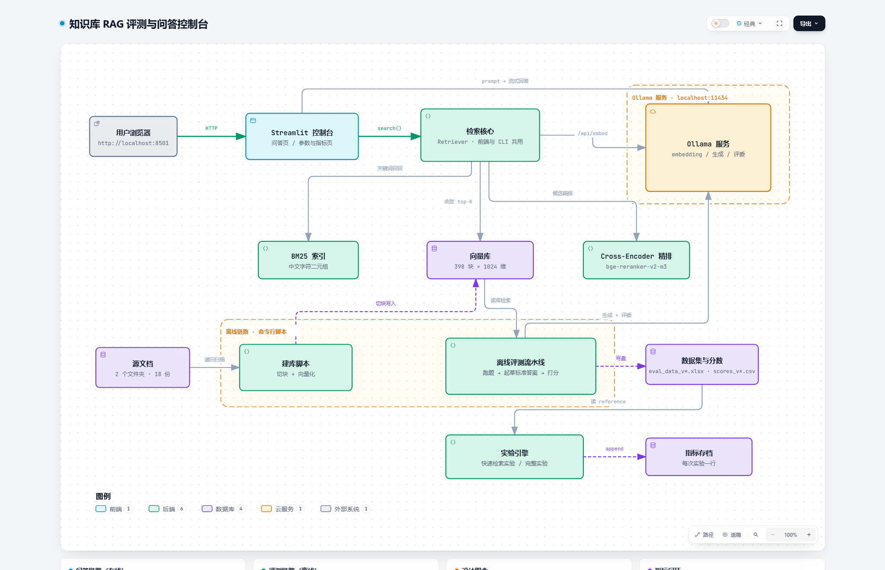

# 从 0 到 1 搭建生产级 RAG：向量库、Rerank 与评测闭环实战

> 一台没有 GPU 的笔记本（i5-1135G7 / 16G 内存），一套中文知识库（18 份文档 / 398 个 chunk），
> 从"能聊天"做到"每个数字都能追溯到哪一步、哪一块导致的"。
>
> 本文不讲概念，只讲**我实际踩过的坑**和**实测出来的数字**：
> rerank 到底值不值？TOP_K 该给几？BM25 混合检索要不要上？
> 这三个问题的答案都在这篇里，而且都有对照实验支撑。

---

## 目录

1. [先说结论：能聊 ≠ 能用](#一先说结论能聊--不能用)
2. [什么叫"生产级"（以及本文不承诺什么）](#二什么叫生产级以及本文不承诺什么)
3. [整体架构：两条链路，一套内核](#三整体架构两条链路一套内核)
4. [选型：为什么我不用 ChromaDB 和 LangChain](#四选型为什么我不用-chromadb-和-langchain)
5. [第一层：知识入库（切块 / 元数据 / 版本指纹）](#五第一层知识入库)
6. [第二层：检索的四段式（向量 → BM25 → RRF → Rerank）](#六第二层检索的四段式)
7. [第三层：评测闭环（本文重点）](#七第三层评测闭环)
8. [调参实战：四组真实对照实验](#八调参实战四组真实对照实验)
9. [踩坑精选（8 条，每条都让你少熬一晚）](#九踩坑精选)
10. [生产级的三条底线](#十生产级的三条底线)

---

## 一、先说结论：能聊 ≠ 不能用

我第一次把这批文档挂到 Open WebUI 上时，效果"看起来不错"——能答、有引用、语气也好。
但当我准备把它交给业务方时，发现了三个致命问题：

| 问题 | 具体表现 |
|---|---|
| **不可观测** | 界面上只给文件名，看不到检索到的原文。答错了，你分不清是"没检到"还是"模型编的" |
| **不可复现** | 改 chunk 大小、换 embedding、开关重排，全靠感觉。同一批问题跑两次，不知道分数该不该变 |
| **不可归因** | 分数掉了，是召回的问题、排序的问题、还是 Prompt 的问题？没有证据 |

这就是为什么我要自己搭一套——**不是再造一个聊天框，而是给 RAG 装一套仪表盘**。

先把我最后跑出来的数字放这儿（后面每一节都会解释它是怎么来的）：

| 指标 | 分数 | 说明 |
|---|---|---|
| faithfulness | 0.963 | 几乎没有编造 |
| answer_relevancy | 0.771 | 被 2 道跨文档对比题拖累（剔除后 0.882） |
| context_recall | 0.927 | 该检回来的内容，检回了 92.7% |
| context_precision | 0.900 | 检回来的内容，排得靠前的占 90% |

**这四个数不是重点，重点是它们能被稳定地复现、能归因、能对比。**

---

## 二、什么叫"生产级"（以及本文不承诺什么）

先把话说清楚，避免误导：本文的"生产级"不是指高可用、高并发、多租户。

我指的是**工程上的四条底线**：

1. **可观测**：每次检索都能看到"哪一块、多少分、来自哪个文件"
2. **可复现**：同样的参数，跑两次结果一致（或者差异在已知噪声内）
3. **可归因**：指标掉了，能定位到检索 / 排序 / 生成哪一环
4. **可降级**：rerank 挂了要能自动退回纯向量，而不是整个系统 500

**本文不承诺**：QPS、横向扩展、权限体系。那些是另一套工程，跟"评测"是正交的。

> 一句话：**评测能力决定你能不能优化，高可用决定你能不能让很多人用。先把前者做对。**

---

## 三、整体架构：两条链路，一套内核



（配图上传到 CSDN 时插入 `架构图-知识库RAG.png`）

```
在线问答   浏览器 ──HTTP──▶ Streamlit 控制台 ──search()──▶ 检索核心 ──/api/embed──▶ Ollama
                                  │  prompt → 流式回答
检索支撑                   ┌──────┴──────┬──────────────┐
                        BM25 索引      向量库      Cross-Encoder 精排
                         (关键词)    (398×1024)     (bge-reranker-v2-m3)

离线评测   源文档 ─▶ 建库脚本 ─▶ 向量库 ─▶ 评测流水线 ─▶ 数据集 / 分数
                (18 份)              (跑题 → 起草答案 → 打分)
```

**关键设计：检索只有一份实现。**

问答页、离线脚本、实验引擎全部调用同一个 `Retriever` 类。
这一点非常重要——否则你一定会遇到"界面上调参有效，命令行跑出来没变"的鬼故事。

---

## 四、选型：为什么我不用 ChromaDB 和 LangChain

### 4.1 不用 ChromaDB：不是它不好，是这个规模不需要

398 个 chunk、1024 维，一次矩阵乘是**毫秒级**：

```python
# 全部"向量数据库"的功能，本质就是这一行
sims = embeddings @ query_vector   # (398, 1024) @ (1024,) -> (398,)
top = np.argsort(-sims)[:5]
```

而引入 ChromaDB 会带来三件事：依赖体量（onnxruntime 等几百 MB）、黑盒持久化、
以及**最要命的——你在代码里拿不到"排第几、多少分、来自哪一块"**。

而这三样，恰好是评测的全部输入。

> 经验法则：**语料 < 10 万 chunk、单机、要调参 → 用 numpy，别用向量库。**
> 真正需要向量库的时候你会知道（多副本、增量更新、按元数据过滤的复杂查询）。

### 4.2 不用 LangChain：版本地狱 + 它把"检索到了什么"藏起来了

我踩过的坑：为了让某个评测框架跑起来，钉了 `langchain-core<0.4`，
结果把机器上其它项目的 langchain 依赖一起打崩了。

更要命的是抽象层：`Retriever → Chain → ...` 一路封装下来，
你想在中间看一眼"实际传给模型的 5 段原文是什么"，得翻半天源码。

**最终方案**：Ollama 的 OpenAI 兼容接口（`/v1`）+ `openai` 客户端 + 评测框架原生 API。
代码里一行 langchain 都没有。

### 4.3 模型选型（全本地，0 元）

| 角色 | 选型 | 为什么 |
|---|---|---|
| Embedding | `qwen3-embedding:0.6b`（1024 维） | 中文检索质量是上限；639MB，CPU 能跑 |
| 生成 | `qwen3:8b` | 本地 CPU 3~5 分钟/题，评测阶段够用 |
| 评委 | `gemma4:31b-cloud` | **必须 ≠ 生成模型**，否则自己判卷分数虚高 |
| 精排 | `bge-reranker-v2-m3`（2.2GB） | 多语言，本地跑不用 Docker |

---

## 五、第一层：知识入库

### 5.1 切块：按语义边界切，别按字数硬切

```python
SEPARATORS = ["\n\n", "\n", "。", "！", "？", "；", ". "]

def split_text(text, size=800, overlap=100):
    chunks, start = [], 0
    while start < len(text):
        end = min(start + size, len(text))
        # 优先在语义边界处断开，找不到才硬切
        for sep in SEPARATORS:
            pos = text.rfind(sep, start + size // 2, end)
            if pos != -1:
                end = pos + len(sep)
                break
        chunks.append(text[start:end])
        start = end - overlap
    return chunks
```

`CHUNK_SIZE=800` 字符、`CHUNK_OVERLAP=100`（12.5%），中文 500~1200 都合理。

### 5.2 元数据：一定要写进去，否则后面做不了筛选和归因

每个 chunk 落盘时都要带这些字段：

```python
metas.append({
    "source":  file_name,      # 文件名 → 回答里要显示出处
    "doc_dir": folder_name,    # 子目录 → 支持"只搜某个文件夹"
    "rel_path": rel_path,      # 相对路径 → 溯源
    "chunk":   index,          # 第几块 → 出问题能回去看原文
})
```

`doc_dir` 这个字段后来救了我：业务方经常说"只在这批需求文档里找"，
有了它就能在检索时把范围外的相似度直接打成 `-inf`：

```python
sims = np.where(mask, sims, -np.inf)   # 范围外沉底
```

### 5.3 版本指纹：换语料/换参数要能自动分家

库名必须包含**决定向量语义的两个参数**：

```python
COLLECTION = f"kb_{EMBED_MODEL}_{CHUNK_SIZE}"   # 换模型或换块大小 → 自动换库
```

同时用**内容指纹**判断语料是否真的变了（我这次语料从 165 块变到 398 块，
版本号自动从 v2 跳到 v3，并自动备份 `config.py`）。

> 别小看这一步。没有版本分家，你会拿"旧语料跑出的分数"去比"新语料的分数"，
> 然后得出一个完全错误的结论。

---

## 六、第二层：检索的四段式

这是整套系统里最值得花时间的地方。我的链路是：

```
问题 ──┬─▶ 向量召回（余弦 top20）  ──┐
       └─▶ BM25 召回（关键词 top20）──┴─▶ RRF 融合 ──▶ rerank ──▶ TOP_K 段
```

### 6.1 向量召回：语义相近，但怕专有名词

```python
qv = embed_one(question)
sims = arr @ qv                      # 单位向量，点积即余弦
top = np.argsort(-sims)[:RETRIEVE_K]
```

它对"意思相近但用词不同"很强，但对**缩写、数字、代码式片段**经常失灵。
实测：问「IRR 二分法怎么算」，纯向量的 TOP3 里有一段**完全不相关**的方法论对比。

### 6.2 BM25：中文分词别迷信 jieba

不装 jieba 也能做中文 BM25——用**字符二元组 + 英文/数字整词**：

```python
_CJK_RUN = re.compile(r"[\u4e00-\u9fff]+")
_WORD    = re.compile(r"[a-z0-9][a-z0-9_.\-]*")

def tokenize(text):
    low = text.lower()
    tokens = _WORD.findall(low)                       # tam_sam_som / irr 保持整词
    for run in _CJK_RUN.findall(low):
        if len(run) == 1:
            tokens.append(run)
        else:
            tokens += [run[i:i+2] for i in range(len(run) - 1)]   # 字符二元组
    return tokens
```

`BLM模型是什么` → `["blm"] + ["模型","型是","是什","什么"]`。
不需要词典，对"关键词命中"够用，而且天然对漏字/多字有一定容忍度。

### 6.3 融合：**不要**把 BM25 分数和余弦相加

这是最容易踩的坑。BM25 分数**没有上界**、余弦在 0~1、cross-encoder 是 sigmoid ——
三者量纲不通，直接相加等于**让"谁的量纲大"决定结果**。

正确做法是 **RRF（倒数排名融合）**，只看名次：

```python
def rrf_fuse(rankings, weights=None, rrf_k=60, k=20):
    weights = weights or [1.0] * len(rankings)
    agg = {}
    for ranked, w in zip(rankings, weights):
        for rank, idx in enumerate(ranked):
            agg[idx] = agg.get(idx, 0.0) + w / (rrf_k + rank + 1)
    return sorted(agg.items(), key=lambda kv: (-kv[1], kv[0]))[:k]
```

量纲无关、零调参、实践上几乎总是优于分数归一化。

### 6.4 Rerank：唯一的大杠杆（后面有数据）

```python
# 先粗排 20 个候选，再让 cross-encoder 逐对打分
cands = vector_and_bm25_pool[:RETRIEVE_K]
scored = reranker.rank(question, cands, top_n=TOP_K)   # 返回 [(原始下标, 分数)]
```

**两个必须注意的点**：

1. **重排后索引会错位**。`rank()` 必须返回**原始下标**，否则 citations 会张冠李戴
2. **分数不可比**。cross-encoder 分数是 0~1 的 sigmoid，跟余弦不是一个东西。
   所有"阈值判断"（比如判断文档里到底有没有答案）**只能用余弦**

---

## 七、第三层：评测闭环

这一节是全文重点。**没有这一层，前面所有优化都是猜。**

### 7.1 四个指标，各自需要什么输入

| 指标 | 评什么 | 需要 `response` | 需要 `reference` |
|---|---|---|---|
| faithfulness | 回答有没有编造 | ✅ | ❌ |
| answer_relevancy | 有没有答到点上 | ✅ | ❌ |
| context_recall | 该检的有没有检到 | ❌ | ✅ |
| context_precision | 检到的排得靠前吗 | ❌ | ✅ |

**这张表藏着一个巨大的省钱技巧**：

> 后两个指标**完全不需要模型重新生成回答**。
> 所以调检索参数（TOP_K / RETRIEVE_K / rerank / BM25）时，
> 可以跳过"重新生成 20 个回答"这一小时，**12 分钟出结果**。

我把这个做成了"快速实验"：

```python
dataset = EvaluationDataset.from_list([
    {"user_input": q, "retrieved_contexts": ctxs, "reference": ref, "response": ""}
])
result = evaluate(dataset=dataset,
                  metrics=[LLMContextRecall(llm=judge),
                           LLMContextPrecisionWithReference(llm=judge)],
                  run_config=RunConfig(timeout=300, max_retries=4, max_workers=1))
```

### 7.2 参考答案必须独立于被测系统（否则 recall 恒等于 1）

这是最隐蔽的一个坑。我第一次生成标准答案时，直接用**评测时的那 5 段上下文**去让模型写答案。
结果 `context_recall` 恒等于 **1.000，标准差 0.0000** —— 指标死了。

**根因**：参考答案里的每一句话，必然能在那 5 段里找到。拿它当"应该召回什么"的标准，
再看这 5 段覆盖了多少，当然永远 100%。

**解法**：起草标准答案时，用**更宽的 top_k（20）重新检索**，让参考答案的信息面明显宽于评测时的 5 段。

```python
REF_TOP_K = 20      # 起草答案用 20 段（评测时只用 5 段）
```

### 7.3 幻觉探针：20% 的题必须是"文档里没有答案"

题库里一定要有一部分问题，答案根本不在知识库里（比如"公司有没有班车""华为 2025 年营收多少"）。

它们**不进检索指标**（不存在"该召回什么"，硬算必然 0 分，是假警报），
但**必须进 faithfulness** —— 这才是它们存在的意义：测模型会不会编。

实测（4 条探针）：

| 探针 | top1 余弦 | 系统回答 |
|---|---|---|
| 公司有没有提供班车 | 0.277 | 根据提供的资料无法回答该问题 |
| 公司什么时候上市 | 0.319 | 同上 |
| 我们公司现在有多少员工 | 0.339 | 同上 |
| 华为 2025 年营业收入 | 0.459 | 同上 |

真问题的余弦在 **0.585~0.840**，探针在 **0.28~0.46** —— 中间有清晰空档，
所以 `SIM_THRESHOLD=0.45` 这个门禁是站得住的。

### 7.4 噪声基准：不知道噪声，就看不懂 delta

同一个配置重复跑，precision 会差多少？

我的实测：**0.0245**。

所以：

- `+0.016` 的提升 → **噪声内**，不能算改善
- `+0.089` 的提升 → 约 3.6 倍噪声，可以判为真实收益
- `−0.196` 的退化 → 8 倍噪声，铁证

> **不建立噪声基准，你就会把随机抖动当成调参成果。**
> 这是"评测"和"看数字"的分界线。

### 7.5 指标存档：一次实验一行 JSONL

```python
record = {
    "run_id": "20261105-141512-5e88",
    "ts": "2026-11-05 14:15:12",
    "mode": "full",                 # full | retrieval
    "version": "v3",
    "n_samples": 16,
    "params": {"TOP_K": 5, "RETRIEVE_K": 20, "RERANK_ENABLED": True, ...},
    "metrics": {"faithfulness": 0.963, "context_recall": 0.927, ...},
    "detail": {"per_item": [...], "seconds": 4320},
}
with open("data/metric_runs.jsonl", "a", encoding="utf-8") as f:
    f.write(json.dumps(record, ensure_ascii=False) + "\n")
```

为什么用 JSONL 不用 SQLite / 平台：**一行一个实验、纯文本能 diff、零额外服务**。
有了它，"上次 TOP_K=3 那组是多少"变成一次筛选，而不是翻聊天记录。

---

## 八、调参实战：四组真实对照实验

语料 398 块 / 20 题（16 可答 + 4 探针）、评委固定、每次只改一个变量。

| 组 | 配置 | recall | precision | 相对基线 | 耗时 |
|---|---|---|---|---|---|
| **基线** | TOP_K=5 · rerank 开 · BM25 关 | **0.927** | **0.900** | — | 12 分 |
| G1 | TOP_K=8 | 0.948 | 0.828 | +0.021 / **−0.072** | 20.5 分 |
| G2 | TOP_K=3 | 0.896 | 0.917 | −0.031 / +0.016 | 15 分 |
| G3 | rerank 关 | 0.859 | **0.704** | −0.068 / **−0.196** | 6.2 分 |
| G4 | BM25 开 | 0.927 | 0.844 | ±0 / **−0.056** | 15.7 分 |

### 结论 1：rerank 是唯一的大杠杆

precision `0.704 → 0.900`（**+27.8%**），是噪声的 8 倍；recall 也涨了 0.068。

逐题看更震撼（关掉 rerank 后）：

| 题目 | precision 开 → 关 |
|---|---|
| 组织 KPI 分成哪几类 | 1.000 → **0.000**（recall 也归零） |
| 华为的 DSTE / BLM / BEM | 1.000 → **0.333** |
| 业绩差距和机会差距的区别 | 1.000 → **0.679** |

**代价**：单题检索从 0.6 秒 → 45 秒（纯 CPU）。这笔账我认为非常划算。

### 结论 2：TOP_K 是一条曲线，5 是拐点

- recall 随 K **单调上升**：3→0.896、5→0.927、8→0.948
- precision 随 K **单调下降**：3→0.917、5→0.900、8→0.828

`TOP_K=8` 比 5 少 **0.072** precision，只换回 **0.021** recall —— 不划算。
`TOP_K=3` 的 +0.016 在噪声内，recall 却真掉了 0.031。

> 想提速请降 **`RETRIEVE_K`（候选池）**，不是降 `TOP_K`。
> 时间花在"20 个候选逐个过 cross-encoder"上，跟最终留几段无关。

### 结论 3：混合检索在"概念型问题"上是负收益

G4 的 recall **一模一样**（0.9271），precision 掉 **0.056**。

逐题看，掉分全集中在「市场洞察有哪些维度」这题：**1.000 → 0.000**。
BM25 把 PPT 里"关键词密度高但内容空泛"的页面顶了上来，挤掉了原本排好的语义片段。

**但这不是说 BM25 没用**。它在纯关键词查询上是明确更强的：

| 查询「IRR 二分法怎么算」 | TOP3 结果 |
|---|---|
| 纯向量 | 组合分析、组合分析、**方法论对比（完全不相关）** |
| 混合 | 组合分析里讲 IRR/二分法的三段 |

**结论**：BM25 是"特定场景的补丁"，不是"默认打开就更强"。
现在默认关闭，只留开关。

### 额外发现：一个脆弱题能主导整张表

「市场洞察维度对比」这道跨文档题的 precision，在四组里是：

| 组 | 该题 precision |
|---|---|
| 基线 | 1.000 |
| G1（TOP_K=8） | **0.000** |
| G2（TOP_K=3） | 1.000 |
| G3（rerank 关） | **0.000** |
| G4（BM25 开） | **0.000** |

也就是说：**16 题里 1 道脆弱题，就能让 precision 均值抖动 ±0.06。**
如果你只看均值，会得出"TOP_K=3 最好"这种局部正确、整体错误的结论。

---

## 九、踩坑精选

### 坑 1：`context_recall` 恒等于 1.0（最隐蔽）

**现象**：四指标里 recall 永远 1.000，标准差 0.0000。

**根因**：标准答案是用评测时那 5 段上下文起草的 → 每句话必然能在上下文里找到。

**解法**：起草时用 `REF_TOP_K=20` 重新检索，让参考答案的信息面明显更宽。

> **一句话**：尺子必须独立于被测对象。

---

### 坑 2：模型回答里冒出一串 `<arg_key:...>`

**现象**：回答里出现 `（注：<arg_key:...> 为系统生成的唯一标识符…）`。

**根因**：这是上一版为了"关掉思考模式"拼进 prompt 的一串来历不明的控制符。
模型不认识它，当成正文复述了出来。

**解法**：换 Qwen3 官方的软开关，在 user 消息末尾加 `/no_think`。

> **一句话**：往 prompt 里塞自己都不理解的 token，等于给模型下毒。

---

### 坑 3：`import ragas` 直接炸 `ModuleNotFoundError`

**现象**：`No module named 'langchain_community.chat_models.vertexai'`。

**根因**：依赖包里那个模块在新版本已经被删了，但 ragas 0.4.3 里写死了 import。

**解法**：往 `sys.modules` 里塞一个空占位模块。最终版本做得更聪明：

```python
for _ in range(6):
    try:
        importlib.import_module("ragas")
        break
    except ModuleNotFoundError as e:
        name = e.name                      # 运行时才知道缺哪个
        if "." not in name: raise          # 顶层包缺失 = 真缺依赖，照常报错
        if not top_pkg_installed(name): raise
        stub(name)                         # 只补"包已装、子模块没了"
```

> **一句话**：**写死依赖名 = 每次升级都要改代码；运行时自适应 = 一劳永逸。**

---

### 坑 4：pandas 3.x 的 `LossySetitemError`

**现象**：往 `reference` 列写字符串报错。

**根因**：pandas 3.x 把全空的列推断成 `float64`，写字符串就"有损"了。

**解法**：强制该列为 object，并把 NaN 换成空串。

---

### 坑 5：`SEARCH_TIMEOUT=60` 误杀正在跑的任务

**现象**：界面偶发「检索超过 60s 未完成」，但任务其实在慢慢跑。

**根因**：开 rerank 后单次检索实测 **45~56 秒**，超时值比真实耗时还小。

**解法**：`SEARCH_TIMEOUT=180`、`GEN_TIMEOUT=600`（本地 8B 出首字要 2~4 分钟）。

> **一句话**：超时不是"设置得越短越安全"，误杀比多等更糟。

---

### 坑 6：下载 rerank 模型卡在 0 字节

**现象**：`huggingface_hub` 进度条永远 0%，或报 `401 ... cas-server.xethub.hf.co`。

**根因**：默认走 Xet 存储，镜像站没鉴权；国内直连本身也不稳。

**解法**：三层兜底 —— 关 Xet（`HF_HUB_DISABLE_XET=1`）+ 镜像 + 直连断点续传；
都不行就用 ModelScope（实测 **33 MB/s，99 秒下完 2.2GB**）。

---

### 坑 7：PowerShell 里 `set HF_ENDPOINT=...` 没生效

**根因**：两层坑 ——
1. PowerShell 里 `set` 是 `Set-Variable` 的别名，`set X=1` **不报错也不设环境变量**
2. 必须在 `import huggingface_hub` **之前**设（这两个库在 import 时就把端点读成常量）

**解法**：`$env:HF_ENDPOINT = "https://hf-mirror.com"`。

---

### 坑 8：管理员窗口启动 → Edge 弹权限框

**现象**：控制台里明明 `Uvicorn server started on ::8501`，但屏幕中间弹 Edge 对话框
「现有实例正在以提升的权限运行，是否重启」。

**根因**：`.bat` 是以管理员身份运行的，而 Streamlit 默认启动时**会自动调浏览器**。
管理员进程去调普通权限的 Edge → 权限不匹配。

**解法**：给 Streamlit 加 `--server.headless true`（只监听、不碰浏览器），
地址打印在控制台里，手动打开。

> **一句话**：**服务真的起来了，别被浏览器的弹窗骗了。**

---

## 十、生产级的三条底线

### 1. 永远保留"降级路径"

rerank 模型没下载、加载超时、推理报错 —— 都应该**自动退回纯向量**，而不是让整个问答挂掉。

```python
scored = reranker.rank(q, cands, k)
if scored is None:                      # 失败 → 记下原因，用余弦结果
    note = f"⚠️ 降级（{reranker.fail_reason[:36]}）"
    return cosine_result
```

**但降级必须显式标注**：静默降级是比报错危险十倍的失败模式。

### 2. 把"成本"也当作评测的一部分

| 环节 | 实测耗时（398 块 / 20 题 / 纯 CPU） |
|---|---|
| 建库 | 16.1 分钟（2.68 秒/块） |
| 批量生成（20 题） | 86 分钟（4.3 分钟/题） |
| 起草标准答案（云端） | 13.4 分钟 |
| 四指标打分 | 正常 5~10 分钟 |
| **快速检索实验** | **12~20 分钟** |

一个"精度 +0.05 但慢一倍"的改动，和一个"精度 +0.02 且不额外花钱"的改动，
在很多业务里后者更值得。

### 3. 先扩充语料和题库，再调参数

我最初 8 道题时，`context_recall` 恒等于 1.000 —— 指标死了，怎么调都没意义。
后来语料从 165 块扩到 398 块、题库从 8 题扩到 20 题，recall 立刻回到 **0.927**，
逐题出现 0.50 / 0.667 / 1.00 的层次。

> **一句话**：**指标饱和的时候，别调参数，去扩容语料和题库 —— 尺子变细了，刻度才会出现。**

---

## 十一、下一步（还没做完的部分）

诚实地说，这套系统现在最大的短板是**跨文档对比题**：

问「BLM / 五看 / MM 流程在市场洞察上有什么异同」，回答里只有 BLM 和五看，
MM 那句是"未在资料中明确定义"。

我拆开看了原因：

1. 相关内容**确实在库里**（`MM方法论.html`），但 rerank 只给它 **0.025 分、排第 17**
2. 换成混合检索，前 5 名**一个没变**（BM25 也救不了）
3. 但用子查询「MM 市场管理流程 环境分析 竞争分析 市场分析 公司自身分析」→
   直接捞到 **余弦 0.719、第 1 名**

**根因**：单查询的语义被"最强的那个来源"占满了。rerank 是单调打分，没有多样性机制。

**解法**：**查询拆分（multi-query）** —— 对比型问题拆成子查询，各检各的，再合并去重。
这是下一步要做的，也是目前唯一被数据证实的解法。

---

## 附：如何复现

```powershell
# 0. 环境
python -m venv .venv
.\.venv\Scripts\pip install -r requirements.txt

# 1. 建库（文档放 docs/ 下，支持 md/html/pdf/docx/pptx）
.\.venv\Scripts\python build_index.py

# 2. 跑题（检索 + 生成）
.\.venv\Scripts\python run_batch.py

# 3. 起草标准答案（务必人工过一遍）
.\.venv\Scripts\python make_reference.py

# 4. 四指标打分
.\.venv\Scripts\python run_eval.py

# 5. 只调检索参数时：跑快速实验（12~20 分钟）
.\.venv\Scripts\python -c "import experiment; print(experiment.run_retrieval_experiment(params={'TOP_K': 8})['metrics'])"
```

---

## 结语

做这套东西最大的收获不是那四个指标，而是**一条可以被反复使用的判断链**：

> 改一个参数 → 跑一次快速实验 → 和噪声比 → 看逐题 → 决定留还是回滚。

这条链让我在这一轮里：

- **否掉了** 三个看起来很合理的改动（`TOP_K=8`、`TOP_K=3`、默认开混合检索）
- **确认了** 一个真实有效的改动（rerank，precision +27.8%）
- **定位到** 一个架构级缺陷（跨文档对比题被最强来源吸走，需要查询拆分）

如果你也在做 RAG，我的建议只有一句：

> **先把评测闭环搭起来，再去调参数。**
> 否则你永远在优化一个你测不准的系统。

---

*如果这篇对你有帮助，欢迎点赞收藏。评论区可以聊聊你踩过的 RAG 坑，尤其是"指标看起来很好但业务不买账"那种。*
