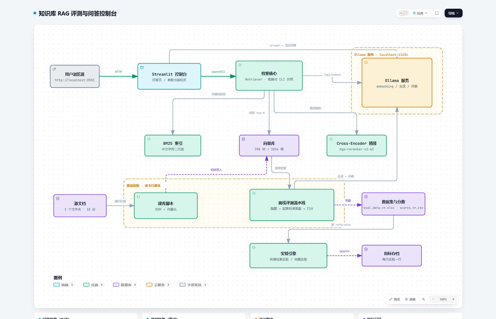

# 知识库 RAG 评测与问答控制台 · 项目报告

> 面向：想把这件事讲清楚的人（技术评审 / 产品 / 上级）。
> 需要「怎么操作」看 [使用说明.md](使用说明.md)，需要「参数是什么」看 [参数手册.md](参数手册.md)，项目定位看 [README.md](../README.md)。

---

## 0. 一页速览

| 维度         | 结论                                                                                                                  |
| ---------- | ------------------------------------------------------------------------------------------------------------------- |
| **做了什么**   | 一套本地 RAG 问答 + 评测工具链：中文文档 → 切块向量库 → 混合召回 → rerank → 生成 → 四指标打分 → 指标存档与对比                                             |
| **当前规模**   | 2 个文件夹、18 份文档、**398 块**、1024 维；题库 **20 条**（16 条有效 + 4 条幻觉探针）。<br>语料演进：v1 165 块 → v2 75 块 → **v3 398 块**（2026-11-05，新增 3 份行业报告） |
| **成本**     | 0 元云费用（本地 CPU + 免费模型），单次完整评测约 40~60 分钟（我手边的电脑很老旧，用GPU应该会快很多）                                                        |
| **核心收益**   | **v3 基线**：recall **0.927** / precision **0.900** / faithfulness **0.963** / relevancy **0.771**；<br>历史对照（v1）：rerank 带来 precision **+10.9%**、recall **+14.3%**              |
| **核心短板**   | 跨文档对比题系统性偏弱（Q10 recall 0.667 / relevancy 0；Q12 直接拒答）；<br>faithfulness 有 1 条稳定 NaN（评委输出截断），有效样本 15/16                                                              |
| **给产品的结论** | 检索增强这条路已验证有效；但**低置信场景必须保留人工复核**，且当前指标只够做「方向决策」，不够做「对外承诺」                                                            |

---

## 1. 项目背景

### 1.1 场景

团队把一批**战略规划方法论 + 客户项目文件 + 需求文档**沉淀成了知识库（Markdown / HTML / DOCX / PPTX）。
业务方希望能用自然语言问出「BCG 矩阵怎么分业务」「现有系统的组合分析得分怎么算」这类问题，
并且答案要能**指回原文**——因为这些问题最终会进入方案文档，不能是模型编的。

> 📌 **语料现状（2026-11-05）**：**2 个文件夹 / 18 份 / 398 块**
> —— 战略规划方法论 15 份 198 块、行业报告 3 份 200 块（3 份 PDF 占了一半块数）。
> 语料经历两次变更：起步 165 块（3 文件夹）→ 75 块（客户文件被移除）→ 现在 398 块（新增行业报告，`VERSION` 已升到 v3）。
> **三个版本的分数不可横向比较**，只有"同语料同题目只改一个参数"的差值可信。

### 1.2 真正的痛点不是「能不能答」，而是「改了参数到底好不好」

项目初期用 Open WebUI 直接挂文件就能聊，但它有三个硬问题：

| 问题 | 具体表现 |
|---|---|
| **不可观测** | 界面只给文件名，看不到检索到的原文，没法判断「答错是检索错还是模型编」 |
| **不可复现** | 改 chunk、换 embedding、开关重排，全靠感觉，没有同一把尺子 |
| **不可归因** | 分数掉了不知道是召回、排序还是生成的锅 |

所以这个项目的目标不是「再做一个聊天框」，而是**给 RAG 装一套仪表盘**：
同一批题、同一套指标、每次只改一个参数，看分数到底动没动。

### 1.3 目标与边界

**做**：
- 文档 → 切块 → 向量化 → 检索（向量 + BM25 + rerank）→ 生成 → 四指标评测
- 参数变更的可复现对比（版本号 + 指标存档）
- 人能直接用的问答界面（带出处、带耗时、带文件夹筛选）

**不做**（明确的非目标）：
- 不做通用知识库产品，不追求多租户/权限/高并发
- 不做模型微调（0 GPU，且数据量不够）
- 不追求线上 SLA，当前是**离线评测 + 内部工具**定位

---

## 2. 系统架构

### 2.1 总览



> 可交互版本（深浅色 / 缩放 / 导出 PNG·SVG）：[知识库总体架构图.html](../assets/知识库总体架构图.html)

### 2.2 两条链路，一套内核

```
在线问答   用户浏览器 ──HTTP──▶ Streamlit 控制台 ──search()──▶ 检索核心 ──/api/embed──▶ Ollama
                                       │  prompt → 流式回答
检索支撑                        ┌──────┴──────┬──────────────┐
                             BM25 索引      向量库      Cross-Encoder 精排
                              (关键词)   (398×1024)     (bge-reranker-v2-m3)

离线评测   源文档 ─▶ 建库脚本 ─▶ 向量库 ─▶ 离线评测流水线 ─▶ 数据集与分数
                (2 文件夹/18 份)         (run_batch → make_reference → run_eval)
                                              │
                                         实验引擎 ──append──▶ 指标存档
```

**关键设计（也是这套东西能跑起来的原因）：**

1. **检索只有一份实现**（`retrieval.py` 的 `Retriever`）。
   问答页、离线脚本、实验引擎全调它 → 前端调参和命令行调参**不可能出现两套行为**。
2. **三种分数严格分家**：
   余弦（0~1）、BM25（无上界）、cross-encoder（sigmoid）、RRF（0.0x）量纲互不相通。
   排序可以用任意一种，但**门禁/诊断只认余弦**（`top1_vector_similarity`）——这条规矩踩过坑（见 §4）。
3. **失败能降级**：rerank 模型加载/推理失败 → 自动退回纯向量，主流程不中断。
4. **可观测**：每次实验写一行 `data/metric_runs.jsonl`（参数 + 指标 + 逐题明细），随时回看。

---

## 3. 技术选型

### 3.1 选型表

| 环节 | 选择 | 主要替代方案 | 为什么 |
|---|---|---|---|
| 向量库 | **纯 numpy 暴力余弦**（`.npy` + `.json`） | ChromaDB / FAISS / Qdrant | 当前 398 块 × 1024 维，一次矩阵乘 1ms 级；装 chromadb 要拖 onnxruntime 等几百 MB，且**看不到**原文与元数据落盘细节 |
| Embedding | **qwen3-embedding:0.6b**（1024 维） | bge-m3 / 英文 all-MiniLM | 中文检索质量是上限；639MB、CPU 可跑；换模型时库名自动变（`kb_{模型}_{chunk}`），不会维度冲突 |
| 生成 | **qwen3:8b** | 更大本地模型 / 云 API | 本地 CPU 能跑（3~5 分钟/题）；评测阶段够用，云端对比留作后续实验 |
| 评委 | **gemma4:31b-cloud** | 本地 8B 当评委 | 8B 评委同一样本波动可达 ±0.2，压过真实差异；评委必须 ≠ 选手 |
| 精排 | **bge-reranker-v2-m3**（2.2GB，本地） | bge-reranker-base / 服务化 rerank | 多语言效果好；本地跑不用 Docker；失败自动降级 |
| 融合 | **RRF（倒数排名融合）** | 分数加权求和 | 三种分数不同量纲，加权求和等于让量纲决定结果；RRF 只看名次，零调参 |
| 中文分词 | **字符二元组**（`bm25.py`，纯标准库） | jieba | 不引依赖、不需要词典；对「关键词命中」够用（`BLM模型是什么` → `blm` + `模型/型是/是什/什么`） |
| 评测框架 | **Ragas 0.4.3 + openai 客户端**（走 Ollama `/v1`） | LangSmith / DeepEval / 自研 | 四指标现成、生态成熟；**不用 langchain**，避免版本地狱 |
| 界面 | **Streamlit 多页**（`st.navigation`） | Gradio / Next.js | 纯 Python 单文件迭代；多页 + `cache_resource` 足够 |
| 指标存档 | **JSONL**（`metric_runs.jsonl`） | SQLite / Langfuse | 一行一个实验、纯文本可 diff、无需额外服务 |

### 3.2 三个反直觉的选择（评审常问）

**① 为什么不用 ChromaDB？**
不是「它不好」，是**这个规模不需要它**。百来块规模的暴力余弦是毫秒级，
而引入向量库会带来：额外的依赖体量、黑盒的持久化、以及最关键的——
**看不到「排第几、多少分、来自哪一块」**。我们要的正是这些。

**② 为什么不用 langchain？**
踩过：钉 `langchain-core<0.4` 会把机器上其它包一起降级，而且 ragas 的链式抽象会把
「检索到了什么」藏起来。最终走 Ollama 的 OpenAI 兼容接口（`/v1`）+ ragas 原生 `llm_factory`，
代码里**一行 langchain 都没有**（环境里仍有 ragas 自己声明的依赖，那不是我们的配置）。

**③ 为什么不微调？**
0 GPU、且高质量标注 <100 条。微调在这个数据量上只会过拟合，
先把**检索**做好（rerank 一项就拿到 +10.9% precision）性价比高两个数量级。

---

## 4. 踩坑记录

按「这条坑会骗到谁」分类，共 15 条。**每一条都真实踩过并修过**，不是纸上谈兵。

### 4.1 会让你「信错分数」的坑（最危险）

| 现象 | 根因 | 修复 |
|---|---|---|
| `context_recall` 恒等于 1.0 | 参考答案用评测时的 top-k 起草 → 每句必然能在上下文里找到 | 起草改用更宽的 `REF_TOP_K=20` 重新检索 |
| 分数虚高 | 评委 = 生成模型，自己判卷 | `JUDGE_MODEL` 必须 ≠ `GEN_MODEL` |
| 0.03 的「提升」被当成果 | 同配置重复跑，precision 就差 0.0245 | 差值 <0.05 一律当噪声；8 题时 recall 刻度是 0.125 |
| 门禁判定错乱 | 拿 rerank 分数（sigmoid）跟 `SIM_THRESHOLD=0.45` 比 | 数据集同时存排序分和余弦，门禁**只**看余弦 |
| 引用来源错位 | 重排后 `metas` 没跟着索引重排 | `rank()` 返回原始下标，用它同时重排 docs/metas/scores |

### 4.2 会让「检索质量莫名变差」的坑

| 现象 | 根因 | 修复 |
|---|---|---|
| 回答里出现 `（注：<arg_key:...>…）` | 旧版把一串来历不明的伪控制串拼进 prompt，模型当正文复述 | 换成 Qwen3 官方 `/no_think` |
| 改成纯向量后 PR 下降但看不出为什么 | 精排失败是**静默降级**的 | 降级必须在界面/日志显式标注；开 rerank 前先跑 `python rerank.py` |
| 减小 `TOP_K` 想让检索变快，几乎没快 | 时间花在 `RETRIEVE_K` 的候选逐个过 cross-encoder 上（约 45 秒/题） | 提速要降 `RETRIEVE_K`，不是降 `TOP_K` |
| 混合检索反而掉召回 | RRF 融合后 BM25 偏好的长段落挤掉了覆盖要点的段（8 题里 1 题 recall 1.0→0.0） | 默认关闭，留开关；等题库扩到含关键词型题再判定 |

### 4.3 工程建设上的坑

| 现象 | 根因 | 修复 |
|---|---|---|
| rerank 模型下不动（hub 卡 0 字节 / `401 cas-server.xethub.hf.co`） | 国内直连不稳 + hub 默认走 Xet | 关 Xet、走镜像、直连断点续传；最终用 ModelScope（33MB/s，99 秒） |
| 设了 `HF_ENDPOINT` 却无效 | PowerShell 里 `set X=...` 是 `Set-Variable` 别名，不写环境变量；且必须早于 `import huggingface_hub` | `$env:HF_ENDPOINT=...`，并在 import 前解析 |
| `import ragas` 直接 `ModuleNotFoundError: ...vertexai` | ragas 0.4.3 硬引用一个新版依赖里已删除的子模块 | `ragas_compat.py` 自动补空占位（只补「包已装、子模块没了」的情况） |
| 写 reference 报 `pandas.errors.LossySetitemError` | pandas 3.x 把全空的列推断成 float64 | 该列强制 object + NaN 转空串 |
| 重定向输出就 `UnicodeEncodeError` | Windows 管道模式回退 GBK | `config.py` 统一把 stdout 改 UTF-8 |
| 控制台刷 `missing ScriptRunContext` | 子线程里碰了 `st.session_state` / `cache_resource` | 检索/生成挪主线程，参数先读好再传进去 |
| 界面偶发「检索超过 60s 未完成」/「生成失败」 | `SEARCH_TIMEOUT=60`、`GEN_TIMEOUT=180` 比真实耗时还紧（实测 45~56s / 2~4min） | 分别提到 180 / 600 |
| 分析笔记混进 `docs/` 后检索变差 | 该目录会被 `build_index.py` 全量索引，笔记成了噪声 | 文档类材料一律放项目根，不入 `docs/` |

---

## 5. 评测结果

### 5.1 测试集与口径

| 项 | 值 |
|---|---|
| 题库 | **20 条**：16 条可回答 + **4 条幻觉探针**（班车 / 上市 / 员工数 / 华为 2025 营收） |
| 探针处理 | 不进检索指标（没有"该召回什么"），但进 `faithfulness` |
| 参考答案 | 云端模型起草 + 人工确认，要求"用原文措辞、1~3 句、无答案写「文档未提及」" |
| 评委 | `gemma4:31b-cloud`（≠ 生成模型），走 Ollama `/v1` |
| **当前语料** | **18 份 / 398 块**：战略规划方法论 15 份 198 块、行业报告 3 份 200 块 |
| 检索配置 | `TOP_K=5`、`RETRIEVE_K=20`、`RERANK_ENABLED=True`（bge-reranker-v2-m3）、`HYBRID_ENABLED=False` |

> 📌 **语料演进**：v1 = 165 块（3 文件夹）→ v2 = 75 块（删了客户文件）→ **v3 = 398 块（新增 3 份行业报告）**。
> 三个版本之间**不可横向比较**：语料、题目都变了。下文 §5.3 的对照表属于 v1 时代的历史证据，只用来回答"rerank/TOP_K/混合检索各自有没有用"，不代表当前语料的水平。

### 5.2 当前基线（v3，2026-11-05）

| 指标 | 分数 | 有效样本 | 解读 |
|---|---|---|---|
| faithfulness | **0.963** | 15 / 16 | 几乎没有编造；1 条（TAM/SAM/SOM）重打两次仍是 NaN，见 §5.5 |
| answer_relevancy | **0.771** | 16 / 16 | 被 2 条 0 分拖累；剔除后其余 14 条均值 **0.882** |
| context_recall | **0.927** | 16 / 16 | ✅ **不再饱和**：逐题出现 0.50 / 0.667 / 1.00 三档 |
| context_precision | **0.900** | 16 / 16 | 逐题 0.333 ~ 1.00，同样有区分度 |

> **这是第一次拿到"有分辨率"的 recall**。v1 时代 recall 恒等于 1.000（语料太小 + 参考答案太窄），
> 新语料 398 块 + 20 道题之后，指标终于能区分"召回好/召回差"了 —— 这比分数本身更有价值。

### 5.3 历史对照：三个参数各值不值得（v1 时代 · 165 块 · 8 题）

| # | 配置 | context_recall | context_precision | 对比基线 | 变化 |
|---|---|---|---|---|---|
| A | TOP_K=5 · rerank **开** | **1.000** | **0.903** | vs B | recall **+14.3%** · precision **+10.9%** |
| B | TOP_K=5 · rerank **关** | 0.875 | 0.815 | — | 基线（纯向量） |
| C | TOP_K=3 · rerank 开 | 0.875 | 0.927 | vs A | recall −12.5% · precision +2.6%（噪声内） |
| D | TOP_K=3 · rerank 关 | 0.875 | 0.875 | vs B | recall 持平 · precision +7.4% |
| E | TOP_K=5 · rerank 开 · **混合检索** | 0.875 | 0.910 | vs A | recall −12.5% · precision +0.7%（噪声内） |

**读数要点：**

- **rerank 是唯一被数据证实有效的改动**：precision +0.089（约 3.6 倍噪声）、recall +0.125（1 题从 0 救回）。
- **`TOP_K` 5→3 不划算**：precision 那 +0.024 在噪声内，recall 掉的 0.125 是真的。
- **混合检索（BM25+向量）在概念型题上没有收益**：8 题里 7 题逐题一致，只有「市场洞察模块」那题 recall 1.0→0.0；
  但在**关键词型查询**上确实更强（"IRR 二分法"：纯向量 TOP3 里有一段完全不相关，混合后全部命中）。
- 8 题时 recall 只有 **0.875 / 1.000** 两档（刻度 1/8），所以「±0.125」= 一题之差，不足以支撑强结论。

### 5.4 rerank 的逐题效果（v1 时代）

| 题目 | recall | precision |
|---|---|---|
| 现有系统的组合分析得分如何得出 | 1.0 → 1.0 | **0.450 → 0.833** |
| BCG 矩阵把业务分成哪几类 | 1.0 → 1.0 | **0.750 → 1.000** |
| 我要设计一个系统市场洞察应该有哪些模块 | **0.0 → 1.0** | **0.450 → 0.589** |
| VRIO 框架用来解决什么问题 | 1.0 → 1.0 | 0.867 → 0.888 |
| TAM,SAM,SOM 是什么如何计算 | 1.0 → 1.0 | 1.000 → 0.917（略微变差） |
| 其余 3 题 | 不变 | 不变 |

→ rerank 的收益集中在**"内容检到了但排得乱"**的题上，和它该起的作用一致。

### 5.5 幻觉探针（v3：4 条全部正确拒答）

| 探针题 | top1 余弦 | 系统回答 |
|---|---|---|
| 公司有没有提供班车？ | 0.277 | 根据提供的资料无法回答该问题。 |
| 公司什么时候上市？ | 0.319 | 根据提供的资料无法回答该问题。 |
| 我们公司现在有多少员工？ | 0.339 | 根据提供的资料无法回答该问题。 |
| 华为 2025 年的营业收入是多少？ | 0.459 | 根据提供的资料无法回答该问题。 |

**4/4 正确拒答**，且 `reference` 全部标成「文档未提及」。
真问题的余弦在 0.585~0.840，探针在 0.28~0.46，中间有清晰空档 —— `SIM_THRESHOLD=0.45` 这个门禁站得住。

### 5.6 失败案例归因：跨文档对比题（本次新增诊断）

两道低分题（Q10 市场洞察对比、Q12 SPAN/FAN/PDC）我们用"宽召回 vs 窄召回"逐层拆开看了，
**失败机制完全不同，修法也不同**：

| 题 | 现象 | 诊断 | 修法 |
|---|---|---|---|
| **Q12** SPAN/FAN/PDC 如何衔接 | recall 0.500 / precision 0.333，模型直接拒答 | 关键块（含 PDC）**在候选池里**（余弦第 3 / 第 7），但 rerank 只给它 **0.650 排第 6**，被 `TOP_K=5` 的线切掉（第 5 名 0.702） | **`TOP_K` 5→6 即可命中**，不是架构问题 |
| **Q10** 市场洞察 · BLM/五看/MM 对比 | recall 0.667 / relevancy 0.000（回答里写"MM流程未在资料中明确定义"） | MM 流程那几块**确实存在**（MM方法论.html），但 rerank 只给 **0.025、排第 17**；换成混合检索（BM25）前 5 名**一个没变** | 单靠 K 或 BM25 都救不了，需要**查询拆分**：子查询"MM 市场管理流程 环境分析 竞争分析 市场分析 公司自身分析"直接把 MM方法论.html 捞到 **余弦 0.719 第 1 名** |

**结论**：跨文档对比题的根因不是"检索不到"，而是**单查询的语义被最强的那一源（BLM）吸走了**。
验证过的解法是"把对比拆成子查询、各检各的、再合并" —— 这是下一步最值得做的检索改造。

### 5.7 性能与成本（v3 实测，2026-11-05）

| 环节 | 耗时 | 备注 |
|---|---|---|
| 建库（18 份 → 398 块） | **16.1 分钟** | 2.68 秒/块（含 3 份大 PDF 的解析） |
| `run_batch`（20 题：检索 + 生成） | **86 分钟** | 4.3 分钟/题（rerank 45 秒 + qwen3:8b 生成） |
| `make_reference`（20 题起草） | **13.4 分钟** | 云端评委起草，0.67 分钟/题 |
| `run_eval`（4 指标 × 16 条） | **73 分钟** | ⚠️ 其中约 50 分钟被 2 条评委超时重试吃掉；正常约 5 分钟 |
| 纯向量检索（单题） | 0.6 秒 | 毫秒级 |
| 开 rerank（单题） | 45~56 秒 | 纯 CPU 的代价 |
| **整条流水线** | **约 3 小时 10 分** | 11:04 → 14:14 |

云费用 **0 元**；电费量级 20~190 元/月（视机器）。

---

## 6. 产品视角结论

### 6.1 一句话结论

> **在当前 20 题内部测试集上（语料 398 块，2026-11-05，TOP_K=5 + rerank），`context_recall` = 0.927、`context_precision` = 0.900、`faithfulness` = 0.963、`answer_relevancy` = 0.771；4 条"文档里没有答案"的探针题全部正确拒答。检索侧已进入可用区间，但 `answer_relevancy` 被两道跨文档对比题拖到 0.771（剔除后其余 14 条为 0.882），这类问题仍需人工复核。**

### 6.2 三条必须同时说清的限制

1. **两条 0 分是真的，不是抖动**：Q10（回答里写"MM流程未在资料中明确定义"）和 Q12（直接拒答）
   重打一遍仍是 `0.000`。它们暴露的是**跨文档对比题的系统性短板**（见 §5.6），不是评委随机。
2. **faithfulness 有 1 条永远打不出分**：TAM/SAM/SOM 那条连续两次都是 `NaN`（评委输出被截断），
   NaN 率 6.25%。也就是说「0.963」实际只覆盖 15/16 条，**不是全样本**。
3. **指标绝对值只在这个语料内有效**：v1(165 块)/v2(75 块)/v3(398 块) 三者语料与题目都不同，
   不能跨版本比较；只有"同语料、同题目、只改一个参数"的差值才可信（噪声量级 0.0245）。

### 6.3 产品侧建议（按投入产出排序）

| 优先级 | 动作 | 目的 |
|---|---|---|
| P0 | **对比型问题走"查询拆分"**：把"BLM/五看/MM 有什么异同"拆成 3 个子查询各检各的，再合并去重 | 已验证能把 MM 内容从 rerank 第 17 名捞到第 1 名，直击最大短板 |
| P0 | **`TOP_K` 5→6 或 8** | Q12 这类"差一名"的题立刻见效（0.650 vs 0.702 的差距） |
| P0 | **低置信显式提示 + 人工复核入口**：余弦 <0.45 或出现"未在资料中"字样时，界面标注"资料不足"并列出命中文件 | 把已知薄弱场景变成可控流程 |
| P1 | 修评委截断：把评分的 max_tokens 调大或换更稳的评委 | 消掉 6.25% 的 NaN，让 faithfulness 覆盖全样本 |
| P1 | 生成层对比实验（`GEN_MODEL` / 关思考 / 提示词松紧） | 减少"过度拒答"（Q12 就属于这类） |
| P2 | chunk / embedding 对比（800 vs 500/1200，qwen3 vs bge-m3） | 召回层的下一档，但要重建库、成本最高 |

### 6.4 一句话给决策者

> 这套东西现在的价值不是"分数好看"，而是**"每个数字都能追溯到是哪一步、哪一块导致的"**。
> 本轮它做了三件实事：把 recall 从"永远 1.000"救回有区分度的 0.927；
> 定位出跨文档对比题的真实病根（单查询被最强来源吸走，不是检索不到）；
> 证实了两条 0 分是真实缺陷而非评委抖动。下一步该投的是**查询拆分**和**人工复核流程**。

---

## 7. 下一步（技术视角）

| 顺序 | 事项 | 预期 | 依据 |
|---|---|---|---|
| 1 | **查询拆分（multi-query）**：对比型问题拆成 2~3 个子查询，各检索 → RRF 合并 → rerank | 直击跨文档对比题；已验证子查询能把 MM 内容捞到第 1 名 | §5.6 |
| 2 | `TOP_K` 5 → 6 / 8（快速检索实验，约 10 分钟） | 捞回"差一名"的题；代价是 prompt 变长、生成变慢 | §5.6 |
| 3 | 修评委截断（max_tokens / 换评委），重打 TAM 那条 | NaN 6.25% → 0 | §5.5 |
| 4 | 生成层：`DISABLE_THINK`、提示词松紧、`GEN_MODEL` | 减少过度拒答（Q12 拒答属此类） | §5.6 |
| 5 | `RETRIEVE_K` 20 → 12 / 8 | 每題 45 秒砍一半，质量不掉 | 参数手册 |
| 6 | chunk / embedding 对比（最贵，最后做） | 召回层的下一档 | 参数手册 |

---

## 附录

### A. 复现一次完整评测

```powershell
cd knowbase
.\.venv\Scripts\python.exe build_index.py     # 建库（内容没变不会升版本号）
.\.venv\Scripts\python.exe run_batch.py       # 检索 + 生成
.\.venv\Scripts\python.exe make_reference.py  # 起草标准答案（人工确认）
.\.venv\Scripts\python.exe run_eval.py        # 四指标打分
.\.venv\Scripts\python.exe compare.py         # 多版本对比
```

调检索参数时用**快速实验**（控制台「参数与指标」页，或 `experiment.py`），2~10 分钟出 recall/precision。

### B. 产物位置

| 内容 | 路径 |
|---|---|
| 向量库 | `vector_store/`（`.npy` + `.json`，当前 398 块） |
| 数据集 / 分数 | `data/eval_data_v3.xlsx`、`data/scores_v3.csv`（当前）；v1 的 xlsx/csv 作为历史保留 |
| 指标存档 | `data/metric_runs.jsonl`（6 条实验记录） |
| 架构图（交互版 / 静态） | `知识库总体架构图.html` / `架构图-知识库RAG.png`（深色版 `架构图-知识库RAG-深色.png`） |
| 文档 | `README.md`（定位）、`使用说明.md`（操作）、`参数手册.md`（参数与台账） |

### C. 已知局限（诚实清单）

- **语料改过三次**：165 → 75 → 398 块。`vector_store/` 只保留最新一份，旧索引已被重建覆盖，
  **v1/v2 的检索结果无法逐字复现**（数据集与分数文件仍在，可复查当时的上下文与回答）。
- 本轮 `run_eval` 有 2 条样本（TAM、DSTE）因评委输出截断而重试约 50 分钟；TAM 那条重打两次仍是 NaN。
- 架构图**没有 commit 级源码证据**：项目不是 git 仓库，图是"读代码后画的系统图"，不是按 commit 校验的代码地图。
- 需求文档 11 份只切出 29 块（平均 1.3 块/份）—— 因为多为原型截图，几乎没有可检索文字。这是"跨文档题偏弱"的物理原因之一。
- 指标存档里早期 5 条实验没有 `HYBRID_ENABLED` 字段（该参数后加），显示为空属正常。
- `faithfulness` 0.974 / `answer_relevancy` 0.925 只在 v1 全量跑过一次，没有做重复实验，**其噪声量级未单独测量**（当前用的是检索侧 0.0245）。
- 建库 16.1 分钟是 **398 块**的实测（2.68 秒/块）；纯 CPU、无 GPU 加速。
